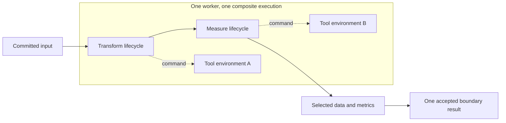

# Composites and Composition

A composite runs several creators under one persistence and cache boundary.
It selects public outputs while its children keep their normal lifecycle and
lineage declarations. Intermediate artifacts can remain temporary.

## Anatomy of a CompositeDefinition

A composite declares input/output roles and a `compose(ctx)` method. The method
builds a deterministic plan using `ctx.input`, `ctx.call`, and `ctx.output`.
References describe connections; they are not futures or artifact values.
The [writing guide](../how-to-guides/writing-composite-operations.md) contains a
complete transform-and-score example.

## How compose() wires operations

`ctx.call` connects a creator or nested composite to input references and
parameters. Its returned `CompositeCall.output(role)` supplies a reference for
another call. `ctx.output(role, ref)` exposes a stream at the outer boundary.
An ordered list of references concatenates streams without deduplicating them.

Parameter-dependent loops can build a fixed sequence of calls. Reading the
contents of a future output to decide the next call is outside this plan model.
Creator children require static input roles and support ZIP or CROSS_PRODUCT
grouping. Store-dependent NAME/LINEAGE grouping and curators remain at the
pipeline level.

## How a composite executes

For each input unit, one worker runs the composite's children sequentially:

Preprocess, postprocess, and native Python execute in the worker environment.
Each command can use its own prepared tool environment. Starting a command
process does not install its dependencies again. The runner places workers
locally, on Modal, or in a Slurm allocation.

Calls selecting the same environment and execution target share one prepared
installation and one resolved target for the submission. The installation is also
reusable by other pipelines. Commands still start separate processes; shared
software does not imply shared Python memory or a resident model.

### Defaults belong to the submitted boundary

A composite may declare resource, batching, and grouping defaults. Supplied
fields on `pipeline.run(Composite, ...)` override those defaults for the outer
step. The author chooses one worker allocation; child resource requests are not
automatically combined. `ctx.call` has no runner or cache settings.

A nested composite expands inside its parent, so its own outer defaults do not
change the parent's units, grouping, or worker allocation. Creator children retain
their own scientific invocation behavior and tool software. Use `Params` for
choices that change the calls in a composition.

### Submission and waiting

`pipeline.submit` returns a `StepFuture`; `.result()` returns its `StepResult`.
`pipeline.run` waits and returns that result directly. Both accept operations
and composites. Their output references identify an exact attempt and store,
so a completed result can feed another run in the same store. See
[reusing another run](../how-to-guides/building-a-pipeline.md#reuse-another-run).
Cancellation applies to the submitted boundary and waits for
owned work to close; an unavailable closure acknowledgement remains uncertain.

## Persistence, lineage, and caching

`ctx.output` selects exported occurrences. Artisan also retains any support
artifacts required by their artifact types. It projects lineage across discarded
intermediates to preserve ancestry between retained inputs and outputs. Direct
relationships between retained artifacts remain distinct from ancestry created
by collapsing a path.

For prediction followed by measurement, export the structure and its metric to
keep their direct relationship. For repeated refinement, export the final
structure and the metric your operation associates with it. The metric may
contain values from many iterations without retaining each intermediate structure
or introducing a special metric category.

Each accepted unit has one cache result for the whole submitted operation or
composite. Children have no independent cache or recovery checkpoint. A worker
can process several units in order; each unit still has its own acceptance and
cache identity. Split work into separate pipeline steps when an intermediate
must be durable and independently reusable.

## What about running everything in one allocation?

All children of one composite unit already share a worker. Use
`batch_strategy.units_per_worker` to group compatible units into an ordered
worker assignment. `artifacts_per_unit` controls the input partition and
therefore the persistence/cache boundary. Changing worker packing does not
change which scientific inputs belong to a unit.

## Nesting composites

Nested composites expand inside the outer plan. They can organize authoring
without adding worker, persistence, or cache boundaries. See the
[nesting guide](../how-to-guides/writing-composite-operations.md#author-composite-nesting).

## Relationship to operations

An operation implements a transformation's lifecycle. A composite connects
transformations and chooses outputs. Both can be submitted through
`PipelineManager.run` and `submit`. An existing worker can also invoke creators
and composites through `Executor.run`, which keeps local artifacts for
the executor's lifetime and does not access a store or persist a result.
