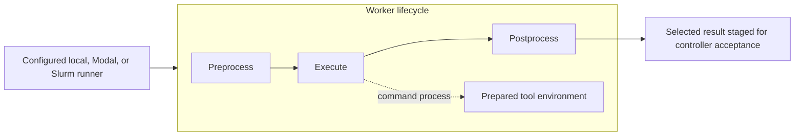

# Execution Flow

`pipeline.run()` prepares inputs, reuses eligible cached work, dispatches the
remaining execution units, and commits their results. Workers stage isolated
files; the orchestrator decides which results become visible to readers and
downstream steps.

---

## Three phases, two roles

Each pipeline step flows through three phases split across two runtime roles:

```
  Orchestrator                    Workers                     Orchestrator
┌────────────────────┐  ┌──────────────────────────┐  ┌────────────────────────┐
│      DISPATCH      │  │        EXECUTE           │  │        COMMIT          │
│                    │  │                          │  │                        │
│  Resolve inputs    │  │  Set up sandbox          │  │  Verify staging files  │
│  Pair multi-inputs │  │  Materialize inputs      │  │  Capture worker logs   │
│  Compute cache key │──│  Run operation lifecycle │──│  Collect staged files  │
│  Check cache       │  │  Capture lineage         │  │  Deduplicate           │
│  Batch + dispatch  │  │  Stage to Parquet        │  │  Write to Delta Lake   │
│                    │  │                          │  │  Complete commit       │
│                    │  │                          │  │  Return StepResult     │
└────────────────────┘  └──────────────────────────┘  └────────────────────────┘
```

The orchestrator coordinates the pipeline and owns Delta Lake writes. Workers
run in isolation, possibly on remote cluster nodes, and return staged files.
For the rationale behind this split, see
[Architecture Overview](architecture-overview.md#the-orchestrator-worker-split).

---

## Dispatch: preparing work

### Input resolution

When a step receives an `OutputReference` (the lazy pointer returned by
`step.output("role")` on a `StepResult` or `StepFuture`), the orchestrator
resolves the selected step attempt's accepted output occurrences. Their order,
multiplicity, and producer attribution survive downstream use: equal content
from two producers is still two occurrences. Explicit caller-provided lists
also retain their order and duplicates for pairing and batching.

Resolution is only the first part of input preparation. The orchestrator also
loads each ID's concrete type, rejects missing or contradictory index entries,
hydrates enough content to validate stored identities, verifies external bytes,
and applies the operation's grouping strategy. Both cache levels and worker
dispatch consume this same prepared snapshot. The runner resolves the required
worker and tool software before cache lookup; normal execution cannot install
dependencies or deploy missing targets.

**Empty input handling.** When every input role resolves to zero artifact IDs,
the step is skipped entirely. The orchestrator records a "skipped" result
(with the reason `empty_inputs`) in the steps table so that downstream steps
and resume logic know the step was attempted but produced no work.

### Multi-input pairing

The orchestrator pairs multiple input roles before batching, so batch
boundaries respect paired groups. The operation's `group_by` selects `ZIP`,
`LINEAGE`, `CROSS_PRODUCT`, or `NAME`; see
[Pairing strategies](operations-model.md#pairing-strategies) for their matching
rules, unmatched inputs, and ambiguity handling.

For operations with a primary input role (such as Filter), a variant called
anchor-based matching pairs each primary artifact independently against every
other role, retaining only complete matches.

### Two-level caching

Artisan can reuse a whole step or individual execution batches.

**Step-level cache** matches the admitted recipe, input partitions, and resolved
software against an eligible terminal step. A hit skips worker dispatch and
records the selected source result under a fresh attempt in the current run.
It never reuses the source step-run ID.

**Execution-level cache** checks each admitted scientific unit. Its identity
includes the compiled recipe and parameters, exact input semantics, and resolved
software. A hit selects an accepted source delivery while other units may
execute. Whole-step and per-unit reuse retain the source's ordered outputs and
producer attribution.

Input identity includes role, order, type, content ID, selected producer, and
frozen associations and references. Fresh consuming IDs are normalized; changing
the selected producer or dependency context changes the identity.

```
prev = pipeline.run(operation=PrevOp, ...)
pipeline.run(operation=MyOp, inputs={"data": prev.output("data")})
    │
    ▼
resolve -> type-check -> verify -> group
    |
    v
whole-step lookup = recipe + prepared units + qualified software
    │
    ├── HIT:  link current step to source executions; return cached outcome
    │
    └── MISS: batch → per-batch:
                  │
                  unit lookup = recipe + exact input semantics + qualified software
                      │
                      ├── HIT:  link current step to cached execution
                      └── MISS: dispatch to worker
```

Every submitted step has a fresh UUID-based attempt ID, regardless of whether
it executes, is cached, is skipped, is cancelled, or fails. Step numbers remain
the logical sequence within a pipeline run. Cache reuse changes neither: the
current step owns its attempt ID and refers directly to existing execution IDs.

An observed `LocalRunner()` environment can run native Python but is not eligible
for durable software cache reuse. Use an explicitly prepared worker when cache
reuse is required. Matching locks alone do not establish equivalence between
native, container, and remote runtime targets.

### Batching and dispatch

Inputs that need execution are partitioned into independently admitted units
for workers.

**Level 1 batching** (`artifacts_per_unit`) controls how many artifacts each
unit processes. An ML inference operation might set this to 1 (one structure per
GPU job). A metrics calculation might set it to 100 (batch for efficiency).

**Level 2 batching** (`units_per_worker`) controls how many units one worker
processes sequentially. Core applies this policy before dispatch, so local and
external runners use identical packing semantics.

Each admitted unit binds its compiled recipe, exact input snapshot, attempt, and
software selection. Dispatch supplies storage roots, scratch location, and
trusted application modules. The worker environment must contain Artisan and
the installed operation package. Packing several units into one worker changes
process reuse, not their independent persistence or cache boundaries.

---

## Execute: running operations

Workers receive admitted work with exact inputs and software bindings. Creators
and curators use their respective lifecycle paths. A composite's creators execute
inside one worker per unit, under the outer persistence boundary.

### Creator operations: the sandbox lifecycle

Each creator execution gets an isolated sandbox on disk:

```
{working_root}/{N}_{op_name}/{ab}/{cd}/{execution_run_id}/
    materialized_inputs/    # Input artifacts written to disk
    preprocess/             # Preprocess working directory
    execute/                # Execute output directory
    postprocess/            # Postprocess working directory
    tool_output.log         # Captured tool stdout/stderr
```

The `{ab}/{cd}` directories (first four characters of the run ID, split into
two levels) distribute sandboxes across the filesystem, avoiding inode
contention on HPC shared filesystems.

The framework runs the [three-phase creator lifecycle](operations-model.md#the-creator-lifecycle)
within this sandbox, with two additional runtime steps:

**Materialize inputs** (before preprocess). Artifact content is written to disk
in the `materialized_inputs/` directory. Config artifacts are materialized last
because they may contain `$artifact` references that resolve to paths of other
materialized artifacts. Operations can request format conversion at this stage
(e.g., materializing with a different file extension) via the `materialize_as`
field on `InputSpec`.

A non-materialized config can instead request typed references with
`resolve_references=True`. Its `$artifact` markers remain intact, while
`inputs.referenced_artifacts(config)` supplies verified dependency objects and
local files to preprocess and postprocess. The operation packages any dependencies
needed remotely into its declared execute inputs. See
[Read typed config dependencies](../how-to-guides/writing-creator-operations.md#read-typed-config-dependencies).

**Finalize** (after postprocess). The framework computes a versioned ID from
each draft's registered type, canonical content, and semantic metadata. It then
protects durable fields and saves an identity snapshot for later integrity
checks.

After normal completion, the sandbox is cleaned up unless `preserve_working`
is set. Failed uploads and uncertain command cleanup retain it for diagnosis.

### Curator operations: the lightweight path

[Curators](operations-model.md#the-curator-lifecycle) receive input DataFrames
and a bound store view in a provider-placed worker. They do not use the creator's
sandbox, materialization, or three-phase lifecycle. Process isolation lets the
operating system reclaim their memory after execution.

File ingestion can return an `ArtifactStreamResult`. The worker converts,
validates, finalizes, and stages one draft before requesting the next. It retains
serialized rows within one shared byte budget, writes unpublished temporary
chunks, and combines each table's chunks into one file before sealing the
complete execution. This extra sequential pass limits memory across tables and
object-store uploads.

Streaming keeps the whole input list as one execution and cache unit. A failure
before completion accepts none of its converted outputs. Temporary files remain
diagnostic evidence; replay restarts the import from the first file. Earlier raw
FileRef registration is separate and can remain after a failed conversion.
An individual CSV is still read and parsed in full. The memory limit therefore
depends on the largest conversion, bounded staging buffers, and retained input
and provenance metadata. See [streamed curator results](../how-to-guides/writing-curator-operations.md#artifactstreamresult-emit-one-draft-at-a-time).

A killed curator process produces a failed step with available diagnostics.
Artisan attempts to persist a synthetic execution failure, and any managed
commands still require cleanup before their files are safe to collect.

### Composite execution

A [composite](composites-and-composition.md) connects creators inside one worker
per input unit. Each child keeps its preprocess/execute/postprocess methods.
Only the selected outer outputs and required support artifacts are retained;
children do not create separate pipeline steps or cache checkpoints.

### Compute routing

The runner places the worker lifecycle. Preprocess, postprocess, and native
Python execution use that worker's environment. A command can select separate
software through its operation's `Environment.from_pixi` declaration:



Pixi, Docker, and Apptainer provide command runtimes from the same locked software
source. A composite may call tools with different declarations while keeping one
worker. Normal invocation reuses prepared targets and never installs dependencies
or deploys a provider. See [environment preparation](../how-to-guides/execute-environments.md).

---

## Lineage capture

After postprocess, Artisan validates `ArtifactResult.lineage` against each
output's `derives_from` contract. It finalizes drafts in their original order,
resolves output indices to artifact IDs, and records the declared edges and
joint parent groups. Input pairing and config materialization add no parents.
See [Provenance System](provenance-system.md) for the declaration contract.

---

## Staging: the contract between workers and orchestrator

Workers never write to shared Delta tables. A creator worker stages selected
output content, occurrence membership, lineage, and required external files,
then publishes its immutable `retained-result.json` seal last. Curator staging
uses its sealed execution record. Neither kind of seal grants acceptance by
itself: the controller verifies its exact admitted owner and complete inventory.

This [staging-commit pattern](storage-and-delta-lake.md#the-staging-commit-pattern)
isolates worker writes and preserves evidence for verification and recovery.
See the storage page for the full directory layout, sharding strategy, and NFS
consistency handling.

### Staging verification

The controller checks the seal, content digests, complete file inventory, and
output contract before acceptance. Missing, changed, or incomplete evidence
cannot become an empty successful result. Providers must deliver files to the
configured staging backend; a scheduler completion message alone is insufficient.

---

## Commit: making results visible

The controller records which complete delivery won an admitted unit, seals its
exact commit plan, and writes the planned effects. Completion follows effect
verification. The step's terminal plan selects those accepted results, including
cache reuse. Supported readers validate the selected ownership and completion;
raw Delta reads can expose unfinished physical writes.
The authoritative sequence is in
[Commit ordering](storage-and-delta-lake.md#commit-ordering).

Commit verification reuses identical artifact content and rejects conflicting
rows under the same ID. Content deduplication preserves distinct occurrences:
new attempts and cache reuse retain their own recorded membership.

### Worker log capture

Runner providers can supply worker stdout/stderr separately from scientific
result delivery. Artisan stores those diagnostics under
`_artisan/worker_logs/<execution_run_id>.log` in the Delta root, keeping sealed
staging immutable. Use
[`inspect_worker_log()`](../how-to-guides/debugging-executions.md#inspect-provider-logs)
to read an exact execution's log, including uncommitted attempts. Failed
executions also get human-readable log files grouped by source execution start
date under `logs/failures/YYYYMMDD/` (UTC). Log delivery is best effort; missing
logs do not block commitment or decide recovery eligibility.

---

## Step tracking

The orchestrator records each step attempt as immutable snapshots in the steps
Delta table. Once API-shape validation accepts a submission, a fresh
`step_run_id` is assigned and `pending` is written before hashing or other
operational work. Execution writes `running`; the attempt then reaches exactly
one terminal status: `succeeded`, `partial`, `failed`, `cancelled`, or `skipped`.
Terminal snapshots never transition again. When a logical step has several
attempts, current-result readers select its newest attempt before checking
whether outputs are available. A newer failure does not reveal an older
successful attempt's outputs. Select an exact `step_run_id` when inspecting
historical results.

The valid lifecycle edges are:

```text
pending -> running -> succeeded | partial | failed | cancelled
       \-> skipped | cancelled
```

This table serves three purposes:

- **Step-level caching** -- lookup requires matching admitted work and verified
  accepted results. `CachePolicy.ALL_SUCCEEDED` selects successful steps;
  `CachePolicy.STEP_COMPLETED` also allows partial steps.
- **Resume** -- opening a recorded run restores its step identities and eligible
  results. Recovery uses recorded acceptance decisions; it cannot infer an
  outcome from arbitrary staging or a worker that merely appears absent.
- **Observability** -- the table records `pipeline_run_id`, operation class,
  parameters, step runner, lifecycle sequence, and timing for every accepted
  attempt.

---

## Error handling across phases

An error's phase determines where Artisan records it:

| Where | What happens | What's preserved |
|-------|-------------|-----------------|
| API-shape validation | Raised immediately in `submit()` | Nothing dispatched, no attempt accepted |
| Operational preparation after acceptance | Attempt becomes `failed` | Fresh attempt ID + error |
| Execute phase (worker) | Caught, failure staged | Input edges + failure record in staging |
| Postprocess/lineage (worker) | Caught, failure staged | Same as execute failure |
| Dispatch infrastructure | Caught in step executor | Failed step + single `error` diagnostic |
| Commit (orchestrator) | Attempt becomes `failed` | Error plus any physical records already written |
| Subprocess OOM (curator) | Broken pool detected | Synthetic failure record staged with diagnostics |

**Recording failures.** Before an execution is sealed, failure-recording errors
are combined with the original error in the returned diagnostic. An error after
seal publication propagates without rewriting the immutable staging evidence.

**Failure logs.** Artisan attempts to write a human-readable log for each
failed execution, containing the run ID, operation name, step number, step
runner, timestamp, traceback, and available tool output. These live in
`logs/failures/YYYYMMDD/YYYYMMDDTHHMMSSffffffZ_executionID.log` alongside
local Delta tables, named by the source execution's UTC start time. Cloud stores
keep these files under the local working root.

The default `continue` policy makes a mix of successes and failures `partial`;
`fail_fast` makes an observed failure fail the step. See
[failure policies](error-handling.md#you-control-the-response) for output
availability and retained evidence.

---

## Cancellation

Request cancellation with `pipeline.cancel()` or the installed SIGINT/SIGTERM
handlers. The request starts cleanup; it does not by itself prove that work
stopped. Artisan records cancellation evidence separately from the step's
lifecycle status:

| Evidence | Meaning | Step outcome |
| --- | --- | --- |
| `requested` | Cleanup is still being evaluated. | No terminal cancellation outcome yet. |
| `confirmed` | Work never started, or required worker and command cleanup was proved. | `cancelled` |
| `rejected` | Work completed before cancellation could take effect. | Its natural outcome. |
| `unknown` | Artisan cannot prove the required cleanup. | `failed`, with no accepted outputs. |

### Cancel checkpoints

Before dispatch, or after waiting for a predecessor, Artisan can confirm that a
pending attempt never started. During local creator or curator work, it must
establish both worker exit and managed command cleanup. Killing the worker alone
is insufficient.

On Linux, an independent supervisor owns native commands before they
start. Cleanup requests a graceful stop, then forces termination within a shared
bounded deadline. Registered nested commands remain covered even after their
parent worker exits. Built-in Docker additionally requires removal of the exact
owned container. Arbitrarily detached work and external daemons are outside this
contract; see [managed command limits](../how-to-guides/configuring-execution.md#keep-managed-commands-in-the-foreground).

Remote cancellation must target the owned call or scheduler job and establish
worker and command closure. A provider accepting the cancellation request does
not supply that proof. Uncertain cleanup remains `unknown` and cannot authorize
new result acceptance.

### Signal escalation

The manager installs signal handlers from the main thread when work begins:

| Press | Effect |
| --- | --- |
| First Ctrl+C | Requests cancellation. |
| Second Ctrl+C | Restores the signal handlers that preceded Artisan's handlers. |
| Later Ctrl+C | Uses the restored handler; Python's usual handler raises `KeyboardInterrupt`. |

Native worker processes ignore SIGINT so the orchestrator handles the request.
Handler installation is skipped outside the main thread. In notebooks, call
`pipeline.cancel()` directly. Cleanup can terminate workers before their execute
phase finishes; use recorded evidence to determine the outcome.

### Recovery and cache reuse

Cancelled steps cannot provide whole-step cache hits. Recovery can finish a
delivery whose acceptance claim was durably recorded before cancellation; it
cannot adopt an unclaimed late result. Already accepted independent units may
remain eligible for ordinary per-unit reuse. Unknown cleanup and diagnostic
replay do not create cache eligibility. See
[Crash recovery](storage-and-delta-lake.md#storage-crash-recovery).

---

## Cross-references

- [First Pipeline Tutorial](../tutorials/01-getting-started/01-first-pipeline.ipynb) -- See the execution flow in action
- [Pipeline Cancellation Tutorial](../tutorials/05-errors-and-control/03-pipeline-cancellation.ipynb) -- Cooperative cancellation in action
- [Compute Routing Tutorial](../tutorials/07-compute-backends/01-compute-routing.ipynb) -- Select worker placement and tool software
